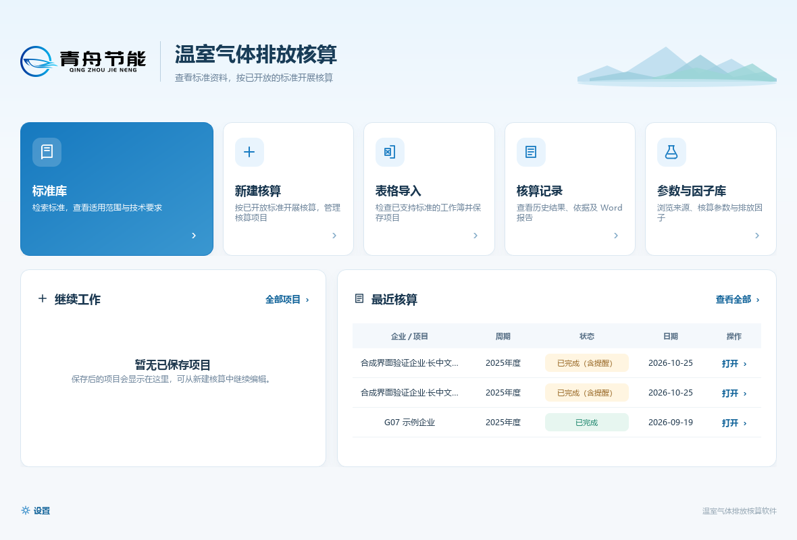
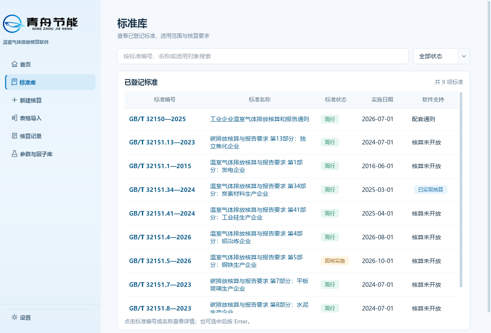
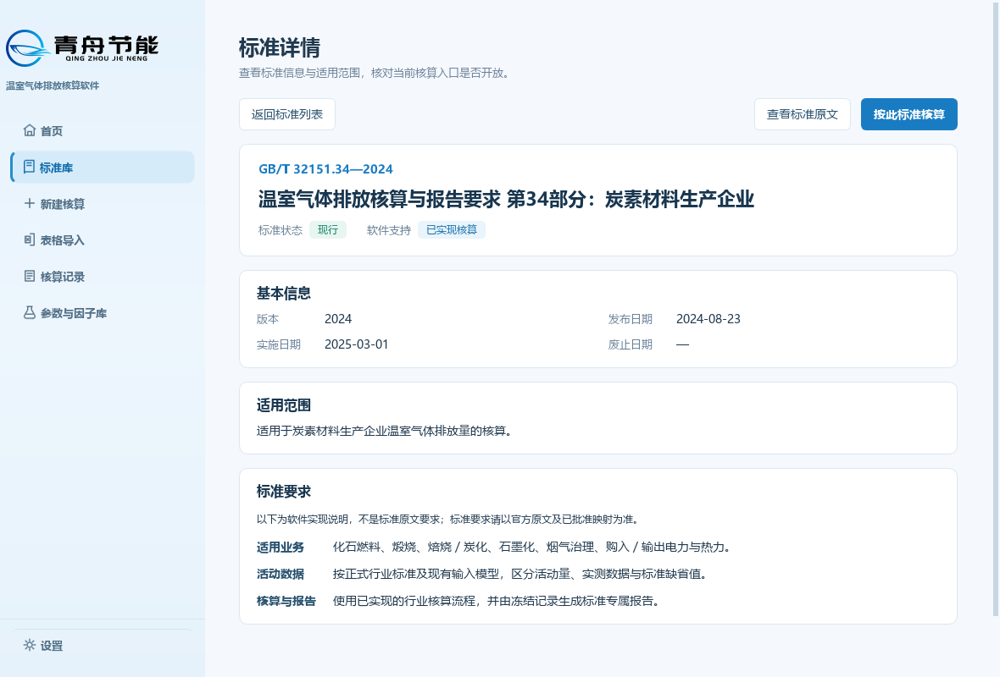
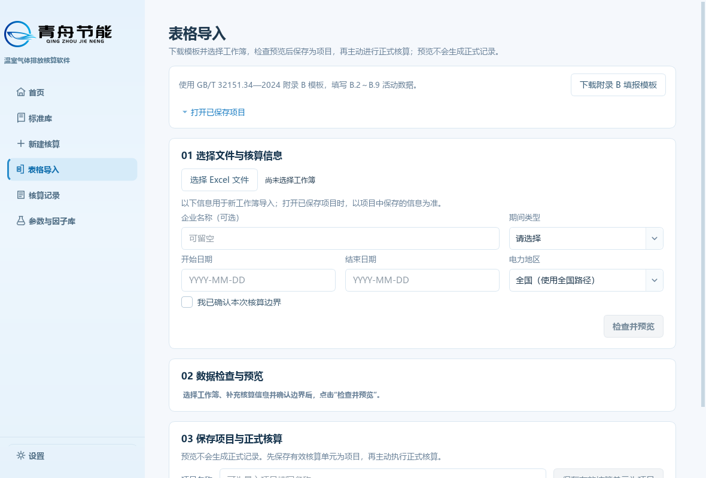
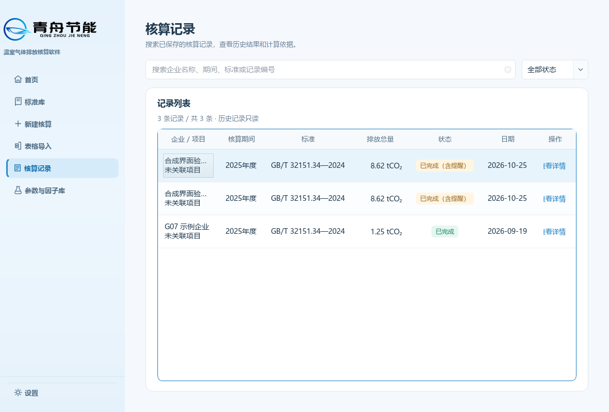
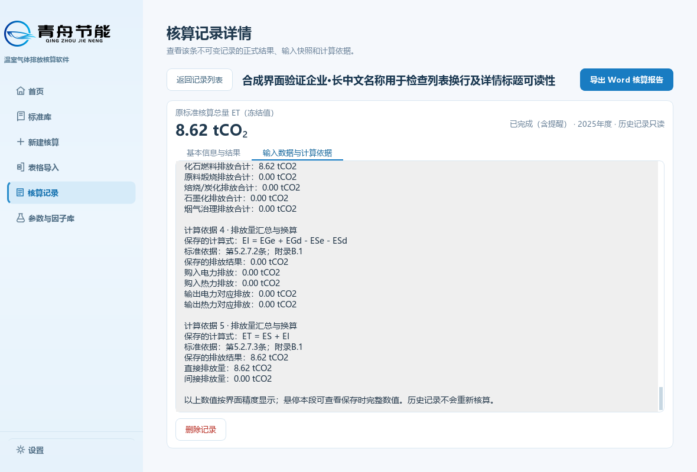
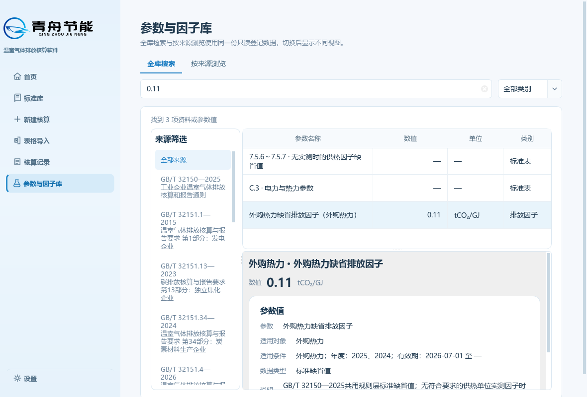
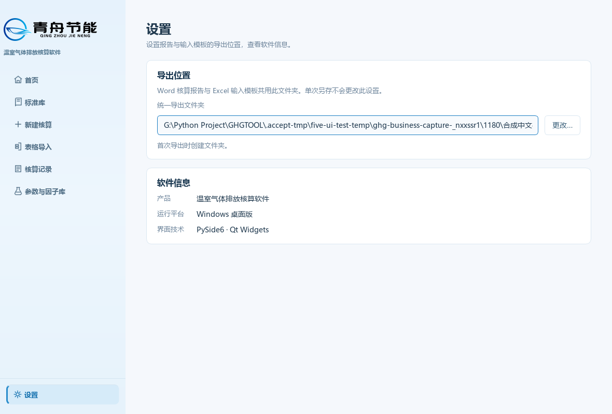

# 碳排放软件 UI 设计参考

日期：2026-10-26。用途：供 ECQuota-Insight 与 EquipEffi 后续 UI 设计参考。

碳排放软件采用淡蓝导航、浅色背景、白色内容区和中文业务表达。可复用的核心是首页与业务页的切换、标准查询、记录查看、操作层级和反馈方式；专业输入、项目保存、核算结果与报告内容由各软件自身业务决定。

本资料描述 PR #60 合并后的实现，不是新的中央规范，也不是第二条产品路线。中央 A 类决定是当前实施依据；下文的颜色、尺寸、组件与截图是 GHGTOOL 实例，可按真实业务调整。三个软件继续独立开发、发布、离线运行，不建立跨仓 UI 运行时依赖。

## 1 依据与版本

| 来源 | 适用方式 |
| --- | --- |
| [中央阅读导航](https://github.com/adgo07/Qingzhou-contracts/blob/main/docs/GUIDE_INDEX.md) | 当前已合并 UI 路由，历史 UI v0.1 不再与 v0.2 并行规定设计 |
| [UI 设计指南 v0.2](https://github.com/adgo07/Qingzhou-contracts/blob/main/docs/ui/UI_DESIGN_GUIDELINES_V0.2.md) | ACTIVE / EVOLVING，分类与设计原则 |
| [产品家族规格 v0.1](https://github.com/adgo07/Qingzhou-contracts/blob/main/docs/ui/UI_PRODUCT_FAMILY_SPEC_V0.1.md) | A-01～A-18、入口名称、产品差异与 OPEN |
| [UI 验收清单 v0.1](https://github.com/adgo07/Qingzhou-contracts/blob/main/docs/ui/UI_ACCEPTANCE_CHECKLIST_V0.1.md) | 按实际改动页面验收，不要求无关全量审计 |
| [PR #60](https://github.com/adgo07/GHGTOOL/pull/60) | 已按 Owner 2026-10-26 明确指令合并；合并提交 `6fc5909646b855494abee55cff6fd95f8d18b4be`，这是本资料的产品源码基线 |
| [PR60 r3 图集](business-pages-v2/refinements-r3/review.html) | 实际 Qt 离屏截图，合成数据；不能代替原生桌面和正式发布验收 |

中央文件读取于 2026-10-26，Git blob 分别为：导航 `7d041cfcedcee27fc4e1904d627ad0a2d9e97fa5`；指南 `d444b286f5714e659586e6a6d3e8e09a62778337`；家族规格 `fcf67da70b97ca996c9abd91d4ca8be1a98b2113`；清单 `fc6360ce7a571ec720ee837572be6bb6f18e8edb`。这些是读取对象身份，不是 Frozen baseline。

### 平台与 Contract 预检查

业务仓基线为上述 PR60 合并提交；[platform-lock.json](../../platform-lock.json) 锁定中央 `ee5feb0cc34dbd99790500fadd0c4c932e202a20`，不变。本任务不涉及中央公共 Contract。相关 Frozen Contract 不作新增采用或修改；本次仅整理 Presentation 现状，不设计 Numeric、Unit、Record 或数据库公共语义。

适用约束：显示不得回流计算；普通页面隐藏内部标识不等于删除证据；记录查看不得重算历史；不得因家族一致性扩大业务能力。无 Frozen 冲突，不需修改中央 Contract。相关 Standard Issue：无新增或需决策的问题，本任务不改变既有软件解释。

**中央能力快照差异：** 家族规格第5～6节和验收清单仍写 GHGTOOL Excel 仅只读预览。当前业务仓已通过 EXB01/PR40 等独立任务开放“预览→保存项目→主动核算”，PR60进一步整理了呈现。中央规格本身允许后续独立开放能力，因此本资料如实记录现状，不回退功能，也不把该流程推广成另外两款软件的强制要求。该差异是待维护的能力快照，不是 Frozen 冲突；本次不改中央文件。

## 2 三软件应保持的一致性

以下为中央要求的简要索引，完整定义以中央家族规格为准。

| 设计对象 | 中央要求 | 碳排放参考与复用边界 |
| --- | --- | --- |
| 首页 A-01～03 | 无侧栏；标准库先于新建；设置独立 | 入口卡片与继续工作、最近核算；后两项按目标软件真实能力选择 |
| 业务壳 A-04～06 | 进入业务页显示侧栏；左侧首页回到无侧栏首页；淡蓝、顶部 LOGO、底部设置；统一 SVG 和视觉语言 | 可复用布局、选中态和动作图标，产品名与业务名称替换 |
| 未开放能力 A-07 | 入口可见但禁用，说明状态 | 不以空页面或假数据伪装已支持 |
| 标准库 A-08～09 | 关键词搜索与标准状态筛选；固定五列；详情连续三分区 | 不增加软件支持筛选；不增加来源、标准关系、发布单位或独立软件支持范围区 |
| 记录 A-10～11 | 搜索、完整列表、独立详情；严格两个页签 | 不增加重新开展业务、技术审计入口或第三页签；底层证据仍保留 |
| 报告 A-12 | ECQuota 选煤有效已保存等级记录的 Word 报告范围 | 不能照搬碳排放附录B、结果字段或宣称 ECQuota 报告已交付 |
| 导入 A-13 | 四个信息区域；依真实能力展示 | 四区域不等于四步向导、四次确认或统一保存机制 |
| 专属库 A-14 | ECQuota 折标系数库；GHGTOOL 参数与因子库 | EquipEffi 不为凑齐导航增加空库 |
| 新建 A-15 | 基本信息、业务数据、数据检查、计算、结果五类功能 | 不强制五页签；专业表单与复杂度保持产品自治 |
| 表达 A-16～18 | 专业简洁、核心依据精炼、中文优先 | 标准编号、单位、品牌和文件格式保留准确原文 |

中央 B 类的具体尺寸、四区域标题、图标资产选择，以及 C 类 OPEN 项不能在本资料中升级成平台决定。首页设置在碳排放当前会进入带侧栏的设置页，这是本地实现选择，中央仍将其承载方式列为 OPEN。

## 3 信息架构和页面路径

```text
启动：首页，无侧栏
  ├─ 标准库 → 标准详情 → 按此标准核算（仅满足真实能力时开放）
  ├─ 新建核算 → 填写与检查 → 计算 → 生成新记录
  ├─ 表格导入 → 检查预览 → 保存项目 → 主动核算 → 查看本次记录
  ├─ 核算记录 → 搜索与完整列表 → 独立记录详情
  ├─ 参数与因子库 → 全库搜索 / 按来源浏览 → 查看参数详情
  └─ 设置，独立于主要入口
业务页：显示并保留左侧导航；左侧首页返回无侧栏首页
```

当前侧栏顺序：首页、标准库、新建核算、表格导入、核算记录、参数与因子库；设置位于底部。业务页选中项具有淡蓝底、左侧蓝线、深蓝文字与图标。页面切换保留各页滚动位置；新建核算输入按既有项目生命周期保留。

源码：[shell.py](../../packages/ui/shell.py) 的 `AppShell`、[routing.py](../../packages/ui/routing.py)、[view_models.py](../../packages/ui/view_models.py)。当前 `ShellViewModel` 校验七个路由，是本地实现约束；不得复制成三个软件永久七项导航规范。

## 4 当前页面设计

### 4.1 首页

顶部品牌、产品标题和简短说明；五个业务入口横向排列，标准库以蓝色卡片突出。下方分为“继续工作”和“最近核算”，空状态解释如何产生内容，列表有进入完整列表的入口。设置位于底部，首页不承担完整业务输入或数据仪表盘职责。



这是 PR60 原版保护图，用于说明首页布局；五页 r3 未重绘首页。源码：`pages.py / HomePage`。可复用品牌区、主入口优先级与空状态；不要要求 EquipEffi 新增草稿和额外保存。

### 4.2 标准库与标准详情

列表上方是关键词框和唯一的标准状态筛选；五列为标准编号、标准名称、标准状态、实施日期、软件支持。编号和名称均可打开同一详情，选择行后 Enter 也可进入。长标题换行，状态用文字配色，目录状态和软件支持分别表达。

详情上方是返回、查看标准原文及按此标准核算操作，正文连续显示基本信息、适用范围、标准要求，不使用详情页签。图中“已实现核算”描述软件实现状态，不代表通过正式标准支持和发布门禁。标准要求区当前明确区分软件实现说明与标准原文。

截图中的标准日期、状态和参数值属于捕获时的夹具（目录夹具日期为2026-09-12），不是当前标准目录或官方参数资料，其他软件不得从截图抄录业务值。





源码：[catalog_pages.py](../../packages/ui/catalog_pages.py) 的 `StandardLibraryPage`。其他软件复用查询与阅读结构，标准范围、术语、业务入口开放条件从自己的正式业务依据取得。

### 4.3 新建核算

当前是复杂核算工作页：核算信息与边界、项目与核算单元、排放源与活动数据、数据检查、计算过程和核算结果。周期支持全年、月份、自定义；专业数据按来源与过程组织，多行材料、电力、热力等使用本地业务组件。快速定位与错误定位帮助返回对应输入。外部 CO₂ 补充单列并明确其非标准排放源性质。

结果显示总量和分项，修改输入后标记原结果过期；再次成功计算产生新记录。页面切换和项目保存不等于成功核算，历史记录不能原地编辑。

源码：[carbon_material_page.py](../../packages/ui/carbon_material_page.py)，以及 [source_directory.py](../../packages/ui/source_directory.py)、[source_cards.py](../../packages/ui/source_cards.py)、[responsive_fields.py](../../packages/ui/responsive_fields.py)、[typed_inputs.py](../../packages/ui/typed_inputs.py)。专业字段、来源路径与核算口径不可跨软件照搬。

**尚未实施的后续设计：** PR60交接中提到的“手动访问未启用来源卡即启用”、热力常用入口简化等，属于后续独立新建核算工作，不是本基线已实现功能。本资料不把旧版新建截图充当当前全页证据；新建页以当前源码为现状依据，后续参考时应补拍目标版本的整页和错误状态。

### 4.4 表格导入

当前四区域为：①模板与说明，含顶部次级“打开已保存项目”；②选择文件与核算信息；③数据检查与预览；④保存项目与正式核算。编号01～03仅用于后三个区域，不是少一个区域。

新导入先选择工作簿，补齐期间、地区与边界，再检查预览；信息或计量路径变化必须重新检查。保存动作明确保存全部有效单元及不保存的待修正单元。预览和保存项目都不产生正式记录。用户主动核算后，“查看本次记录”成为主操作，“再次核算并新增记录”降为次级，避免把查看误认为再次计算。

打开已保存项目展示保存时的输入上下文，隐藏但不覆盖新导入草稿。当前生成记录与历史所选记录分别查看，关联失败保留恢复提示。



源码：`pages.py / ExcelImportPage`、[excel_import_components.py](../../packages/ui/excel_import_components.py)。ECQuota 未开放导入时保留禁用入口；EquipEffi 按其批量分析与结果工作簿流程组织四区，不能引入碳排放的项目保存前置。

### 4.5 核算记录与详情

记录列表包含搜索、状态筛选、数量说明和完整记录访问。紧凑列显示企业/项目、期间、标准、排放总量、状态、日期和查看操作。详情是独立页面，上方返回列表、企业名称和导出 Word 操作；突出冻结总量、周期、状态与历史只读属性。

两个页签名称固定为“基本信息与结果”“输入数据与计算依据”。第二页签使用冻结的业务输入、参数来源、业务计算依据和标准定位；旧记录缺少新表式时提供可读回退，不用当前目录补造历史。宽表在表内横向滚动，单位和脚注保持清晰，完整值保留于提示及无障碍描述。普通记录页无技术审计入口，也不提供基于记录重新开展业务。





源码：`pages.py / RecordLibraryPage`、[record_experience.py](../../packages/ui/record_experience.py)、[record_tables.py](../../packages/ui/record_tables.py)、[report_export.py](../../packages/ui/report_export.py)。删除记录为独立危险操作，二次确认并留审计；Word报告消费保存的记录，不重算。

### 4.6 参数与因子库

“全库搜索”和“按来源浏览”是同一只读登记数据的不同视图。搜索包含分类筛选、左侧来源、右侧结果和详情；来源长名称换行，结果较少时留出详情空间。详情优先突出参数名称、数值和单位，再给适用对象、条件及来源依据。



源码：`catalog_pages.py / ParameterFactorLibraryPage`。可供 ECQuota 参考浏览、检索和来源阅读方式；查询注册数据不等于获得编辑能力，也不等于该值必然适用于当前计算。EquipEffi 不强制增加此页。

### 4.7 设置

当前两块内容：“导出位置”和“软件信息”。报告与输入模板共享导出目录，单次另存不改变统一设置。路径支持查看、选择和错误反馈；软件信息显示产品、运行平台与界面技术。当前此页含技术栈说明，是实现现状，不是三软件必须复制的字段。



图中的路径是历史截图夹具，不是部署要求或本机默认目录。源码：`pages.py / SettingsPage`、[export_location.py](../../packages/ui/export_location.py)。

## 5 视觉参数和样式层级

基础主题来自 [design_tokens.py](../../packages/ui/design_tokens.py)；PR60五页局部样式来自 [business_page_style.py](../../packages/ui/business_page_style.py)。后者覆盖标准库、参数库、导入、记录、设置，不是新的应用全局主题。下表为当前实现值，单位为 Qt 样式或布局的逻辑像素，不能当作各 DPI 下截图物理像素，也不是中央冻结 token。

| 项目 | 当前参考值 | 用法 |
| --- | --- | --- |
| 品牌蓝 | `#197CC2` | 主操作、重点链接、选中状态 |
| 主文字 / 次文字 | `#213A4F` / `#698198` | 正文与说明形成层级 |
| 页面 / 内容区 | `#F5F8FC` / `#FFFFFF` | 浅底白区，避免大量高饱和色 |
| 边框 / 弱背景 | `#DAE7F1` / `#F7FAFD` | 内容分组和只读输入 |
| 成功 / 提醒 / 废止 | `#168268` / `#956420` / `#B9484A` | 同时保留中文状态，不单靠颜色 |
| 侧栏 | 宽242；品牌区高111；导航项高46、圆角9 | 淡蓝纵向渐变；设置与业务导航分隔 |
| 内容宽度 | 业务最大1440；首页最大1480 | 居中；整体禁用横向滚动，宽表局部滚动 |
| 页面边距 | 业务约窗口宽度的3.4%，限制22～48；首页30或54 | 首页窗口宽≤1240时用30 |
| 字体 | Microsoft YaHei UI、Microsoft YaHei、sans-serif | 当前系统字体回退，不新增字体打包依赖 |
| 页面标题 | 基础25/700；五页局部24/600 | 字号/字重，区分两层样式 |
| 分区标题 / 正文 | 五页16/600；详情正文14 | 描述13；表头13、正文14 |
| 结果主数值 | 五页记录26/600 | 配合单位与冻结属性，不放大所有数值 |
| 内容区圆角 | 基础卡14；五页局部10 | 五页区内边距左右20、上下18、间距12 |
| 五页输入 / 按钮 | 样式最小高度20，加上下padding8及边框；圆角6 | 20不是控件最终总高；实际高度仍受Qt字体和布局影响 |
| 表格行高 | `ReadableTable` 最小40，按换行内容重新计算 | 标准/记录等页面有局部更高配置，不统一固定死行高 |

按钮层级：蓝色实心主操作；白底描边次操作；行内查看采用轻量蓝色文字；删除用红色文字并独立放置；禁用使用低对比底色但保留可读原因。成功后主操作应对应下一步用户任务，如“查看本次记录”，不是继续突出重复生成。

复选框局部增强勾选、半选、禁用勾选和焦点绘制，保留原生事件与焦点行为。表格长文本按最终列宽换行并重算行高，不截断单位、来源或最后一行。完整数值与底层业务值分别保留，显示修约不改变正式结果。

## 6 品牌和资产

| 资产 | 当前路径 | 参考方式 |
| --- | --- | --- |
| 青舟品牌 LOGO | [qingzhou_logo.png](../../resources/branding/qingzhou_logo.png) | 当前实际为PNG，中央统一SVG要求针对动作图标；不要误称所有资产都是SVG |
| 首页 / 标准 / 新建 | [home.svg](../../resources/icons/home.svg)、[standards.svg](../../resources/icons/standards.svg)、[new.svg](../../resources/icons/new.svg) | 相同动作保持相同语义 |
| 导入 / 记录 / 库 / 设置 | [excel.svg](../../resources/icons/excel.svg)、[records.svg](../../resources/icons/records.svg)、[factors.svg](../../resources/icons/factors.svg)、[settings.svg](../../resources/icons/settings.svg) | 用户标题为“表格导入”；资产文件名不等于显示文案 |
| 下拉箭头 | [chevron-down.svg](../../resources/icons/chevron-down.svg) | 控件内的统一提示 |
| 图标加载 | [icons.py](../../packages/ui/icons.py) | 默认18逻辑像素；按状态着色，保持比例 |

目标软件可在自己的资源目录维护适用资产，保留来源和版本，不在运行时引用 GHGTOOL 安装目录。品牌、图标集和 token 在中央仍允许演进，不因这份实例资料永久冻结。

## 7 跨软件使用方式

| 内容 | ECQuota-Insight | EquipEffi |
| --- | --- | --- |
| 新建 / 记录命名 | 新建对标 / 对标记录 | 新建分析 / 分析记录 |
| 专属库 | 折标系数库，开放状态以业务仓为准 | 当前不强制增加 |
| 新建页 | 用本标准对标对象、数据和结论填充五类功能 | 用设备、工况、分析数据与结果填充五类功能 |
| 记录详情 | 两页签内呈现保存时等级与依据 | 两页签内呈现保存时设备分析与依据 |
| 导入 | 未开放则禁用，不为一致性提前实现 | 使用已有批量处理能力，不新增草稿或额外保存手续 |
| 报告 | 按中央A-12的选煤范围及本仓实现门禁 | 按本仓批准范围，不复制碳排放报告结构 |

建议按“壳与标准库→记录→新建业务→导入与专属库→设置”的阅读顺序评估参考。每个目标仓实施前再核对自己的最新源码和中央当前版本；先确认真实能力，再替换名称、字段与结果表达。本次未审计两个目标仓当前实现，中央快照不能替代其现场核验。

可直接参考：淡蓝壳、标题与操作层级、五列标准列表、三分区详情、两页签记录、长文本表格、中文反馈、禁用说明。需按业务适配：项目与单元、排放源目录、参数选择、附录B表、Word内容和计算按钮行为。不得移植：碳排放算法、项目专属精度、标准解释、数据库结构、运行时表单状态及正式支持结论。

## 8 验收场景和证据入口

后续目标软件只对实际改动做验证，按中央清单记录 PASS / FAIL / OPEN / N/A：

1. 首页无侧栏，标准库优先，设置独立；进入业务和返回首页状态正确。
2. 标准搜索、五列、编号/名称双入口、连续详情、未开放标准按钮正确。
3. 记录全量可达，严格两页签，查看不新增、不重算、不覆写记录。
4. 导入的四区域与真实能力一致；无效输入、重新检查、成功后的主操作明确。
5. 中文长名称、长来源、长路径、空列表、多行表头、宽表、完整数值可读。
6. 选中、未选、半选、禁用、焦点可区分；键盘访问和错误定位不改变业务值。
7. 在目标窗口尺寸及100%/125%/150%等实际DPI下检查，离屏图不能代替鼠标、IME、读屏和原生Office验证。

| 资料 | 内容与适用范围 |
| --- | --- |
| [r3精选38图](business-pages-v2/refinements-r3/review.html) | 1180×800和1440×1000，五页与控件状态；原完整捕获86整窗+6控件，精选不冒充全部92图 |
| [捕获身份](business-pages-v2/refinements-r3/capture-summary.json) | 图像与29项源码指纹；本次核对当前源码29/29一致（统一LF换行） |
| [限定视觉复核](business-pages-v2/refinements-r3/astra-receipt.json) | 既有视觉结论及范围限制，不是本次新做独立验收 |
| [本地历史完整测试摘要](business-pages-v2/refinements-r3/local-full-summary.json) | 保留原1121通过/1失败，不能被CI成功改写 |
| [PR60 GitHub Actions](https://github.com/adgo07/GHGTOOL/actions/runs/40174557497) | 合并前head `ac06ca7e9d508b3956fef15fdad3d08d4b955f0a` 的两个required jobs成功；不是本地执行证据 |
| [界面回归](../../tests/test_business_pages_visual.py)、[壳回归](../../tests/test_g03_shell.py) | 目标仓可参考场景，不复制与碳排放字段强绑定的断言 |

PR60已合并不等于关闭所有验收缺项。真实用户日志路径访问失败原因、原生桌面/IME/Office/人工DPI、企业样例与干净机等未验证事项仍保留；不宣称商业Release或整标准SUPPORTED。
